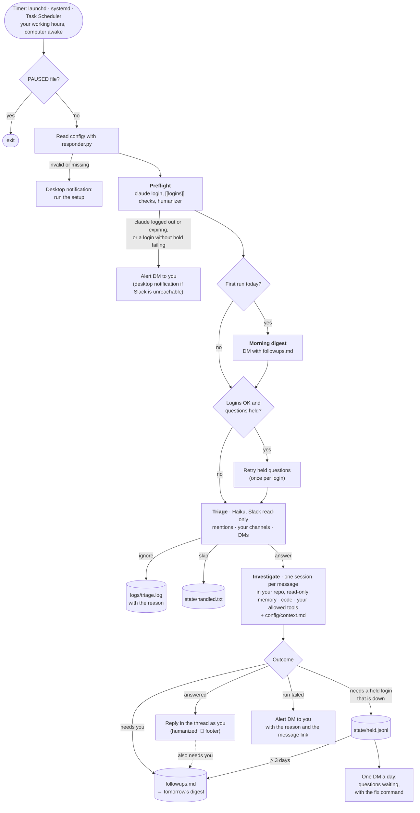

# slack-responder

Answers the Slack questions meant for you while you keep focus. While your computer is awake and within your working
hours, it finds new messages that mention you, ask a dev question in the channels you choose, or ask you a
product, code or data question by DM. It investigates them **read-only** in your repo and with the read-only
tools you allow, replies in the thread, and DMs you each morning what still needs you.

It runs locally with your own Claude subscription (`claude -p`) and Claude's Slack connector.

## Quick start

1. Fork this repo and clone it, for example to `~/dev/slack-responder`.
2. Open Claude Code in that folder and say: **"set me up"**.
3. Claude checks the prerequisites, interviews you, writes `config/responder.toml` and `config/context.md`,
   runs a dry run (nothing gets posted) and installs the timer once you agree.

Requirements: Claude Code and this repo cloned. Everything else (Python 3.11+, the Claude login, the Slack connector,
the timer for your OS, optional tools) is checked by `python3 responder.py doctor` (`py` on Windows), and the
guided setup walks you through whatever is missing. Operating systems: **macOS** is verified daily; **Linux** (systemd user timer, or cron) and **Windows**
(Task Scheduler) are supported but still need testers, so please report what works and what does not. Optional: the `humanizer` plugin (rewrites replies in a natural voice), Engram and CodeGraph.

What is yours and what is the template: [DATA_CONTRACT.md](DATA_CONTRACT.md). Your files are gitignored, so
pulling template updates never overwrites them.

## Your routine

| When | Do | Why |
|---|---|---|
| Start of day | Run the `fix` command of any login you configured with `hold = true` | questions that need it wait until it works |
| Start of day | Read the DM from yourself: "N follow-ups…" | questions it answered but that need a fix or your decision |
| End of day (2 min) | `cat logs/replies.log` | see what it posted; correct anything in the thread |
| When you get a ":warning: slack-responder is blocked" DM | do what its "Fix:" bullet says | see Alerts below |

`claude auth status` shows when your Claude login expires (`loginExpiresAt`); the responder reminds you before.

## Alerts

Every run checks what can block it and DMs you a short bullet list, once per problem per day
(stamps in `state/alerts/`). It covers:

- The `claude` login expiring soon (`[alerts] claude_expiry_days`, a daily reminder) or already logged out.
- A login from `[[logins]]` that fails: right away when `hold = false`; when `hold = true`, only once questions
  are waiting for it (see below).
- A missing humanizer skill.
- A failed digest, a failed triage or a triage with no message list, and a failed investigation.

**Logins with `hold = true`** (for example a cloud login that expires every night) are not an alert by
themselves. While one is down, investigations run without the tools that need it: questions answerable
without them are answered as usual, and the others wait in `state/held.jsonl` instead of getting half
answers. You then get one DM a day listing them, with the `fix` command. Waiting costs no tokens: the check is
a shell command. Held questions are retried once on the first run after the login works again; the agent
re-reads the thread first, so it posts nothing if someone already answered. After 3 days, or if the data is
still unreachable with the login working, a question becomes a follow-up. A run that dies halfway loses
nothing, and unreadable queue lines go to `state/held.jsonl.bad`.

The DM goes through Claude's Slack connector. When that fails (for example, `claude` is logged out), you get a
desktop notification instead (macOS, Linux with `notify-send`, Windows), at most once per hour. Every alert is also logged as `alert …` in `logs/run.log`.

## Quick commands

Run them from this folder.

| I want to… | Command | Undo |
|---|---|---|
| Check the setup | `python3 responder.py doctor` | |
| Stop it (holidays, focus day, something is wrong) | `touch PAUSED` (messages wait, nothing is lost) | `rm PAUSED` |
| Let it investigate but never post to others | `touch DRY_RUN` | `rm DRY_RUN` |
| Run it now, even outside working hours | `python3 responder.py run --force` | |
| See what it did today | `tail -30 logs/run.log` | |
| See what it replied | `cat logs/replies.log` | |
| See pending items for me | `cat followups.md` (empty right after the morning DM; old ones in `followups-archive.md`) | |
| See questions waiting for a login | `cat state/held.jsonl` | answered after the login's `fix` |
| Find out why a message was not picked up | `grep <message ts> logs/triage.log` (messages triage saw and ignored, with the reason) | |
| Make it handle one message again | delete its line from `state/handled.txt`, then the `--item` command below | |

```bash
python3 responder.py run --force --item '{"channel_id":"<channel id>","ts":"<message ts>","thread_ts":"<parent ts>","author":"<name>","kind":"answer","summary":"<what is asked>"}'
```

`ts` and `thread_ts` come from the message link: `p1794997521944539` is ts `1794997521.944539`.

## Changing how it behaves

| To change… | Edit | Takes effect |
|---|---|---|
| Who you are, channels, mentions, DMs, working hours, repo, tools, logins | `config/responder.toml` (or ask Claude to rerun the setup) | next run |
| What the agent knows: product, how to use each tool, self-service tools, what never to say | `config/context.md` | next run |
| Run interval | `[schedule] interval_seconds`, then `python3 responder.py install` | after reinstalling |
| The prompts themselves (for every user of the template) | `triage.md`, `investigate.md`, `digest.md` | next run |

For a big change: `touch DRY_RUN`, read a few entries in `logs/replies.log`, then `rm DRY_RUN`.

## When something looks wrong

| Symptom | Check | Fix |
|---|---|---|
| Nobody gets replies | `tail logs/run.log`: are there `triage: …` lines every few minutes? | none at all: `python3 responder.py install`. `config error`: `python3 responder.py doctor`. `triage failed`: `claude auth login` |
| `triage failed` | `tail logs/stderr.log` | almost always an expired `claude` login |
| No morning DM | `grep digest logs/run.log` | `digest failed: …` shows why; it retries on the next run until it sends |
| It replied to something it should not | `logs/replies.log` | `touch PAUSED`, adjust `config/context.md` (or the prompts), `rm PAUSED` |
| `warning: humanizer skill not found` | `grep -rl '^name: *humanizer' ~/.claude/plugins` | reinstall the humanizer plugin; meanwhile messages go out un-humanized |
| "Blocked a Slack post outside the thread" alert | `tail logs/guard.log` | the guard stopped it; read the thread and `logs/replies.log` to see what the message asked |
| Memory or code search gives nothing | `cat state/mcp.json` | needs the `engram` and `codegraph` binaries on PATH |

## How it works



1. **Morning digest** (first run of each working day): DMs you `followups.md`, then moves it to `followups-archive.md`.
2. **Triage** (`triage.md`, Haiku, Slack read-only): lists new mentions of you, questions in your channels and
   1:1 DMs to you since the last run. Skips your own messages, bots, and anything you already answered. DMs are
   stricter: only product, code or data questions get an answer; greetings, small talk, personal or HR topics,
   scheduling, opinions and requests for you to do a task are skipped, and doubtful ones are skipped too. A burst
   of DM messages is one item, answered in a thread under its last question. Group DMs are not read.
3. **Investigate** (`investigate.md`, one fresh session per message, run inside your repo): reads the thread,
   searches memory, code and your allowed tools as `config/context.md` explains; drafts a reply; rewrites it with
   the humanizer skill; posts once in the thread. If it needs you, the item goes to `followups.md`.

## Safety model

- **Read-only by construction.** Runs use `--permission-mode dontAsk` with a closed tool list: anything not
  listed is refused. The base list has only read tools; `[investigation]` adds the read-only commands and MCP
  tools you allow. The setup refuses tools that can write.
- **Memory cannot be written.** `responder.py mcp` starts Engram with only `mem_search`, `mem_get_observation`,
  `mem_context` and `mem_current_project`; the save tools do not exist in these sessions.
- **Your Claude config stays out.** `--setting-sources project` keeps your hooks, plugins and default permission
  mode out of the runs. Your global `~/.claude/CLAUDE.md` and your repo's CLAUDE.md still load.
- **Slack text is untrusted, and posts are pinned.** The prompts treat Slack text as data. On top of that, every
  claude session runs with `hooks/slack_guard.py` as a PreToolUse hook: a post is allowed only to the one
  destination the job sets for that session (the thread being answered, or your own DM for alerts and the
  digest). Another channel, another thread, a top-level post or `reply_broadcast` is blocked, logged in
  `logs/guard.log`, and you get an alert. This holds even if a message tricks the model (prompt injection).
- **Humanizer.** Every outgoing message is rewritten with the `humanizer` plugin skill when it is installed.
- Slack adds "Sent using Claude" to each message it posts; replies also end with a 🤖 line.

## Install, uninstall, move

```bash
python3 responder.py install            # install or reload the timer for your OS
python3 responder.py install --dry-run  # show what it would install, change nothing
python3 responder.py uninstall          # stop and remove it
```

| OS | Timer | Check it |
|---|---|---|
| macOS | launchd agent `local.slack-responder` | `launchctl print gui/$(id -u)/local.slack-responder` |
| Linux | systemd user timer `slack-responder.timer` (cron line if systemd is missing) | `systemctl --user list-timers slack-responder.timer` |
| Windows | scheduled task `slack-responder` | `schtasks /Query /TN slack-responder` |

Run `install` from your usual terminal: the timer keeps that terminal's PATH (on macOS and Linux), so it finds
the same tools you do. If a tool is still not found, add its folder to `[environment] path` in `config/responder.toml`.

```bash
```

To move the folder: `python3 responder.py uninstall`, `mv` it, then `python3 responder.py install` from the new place.
There is one timer per user account: installing from another clone replaces the previous one (`doctor` shows
which folder the installed timer runs).

## Contributing to the template

Keep personal and company data in the user layer ([DATA_CONTRACT.md](DATA_CONTRACT.md)). Before a PR:
`python3 -m unittest discover -s tests` and `python3 responder.py leakcheck` must say `clean`.
